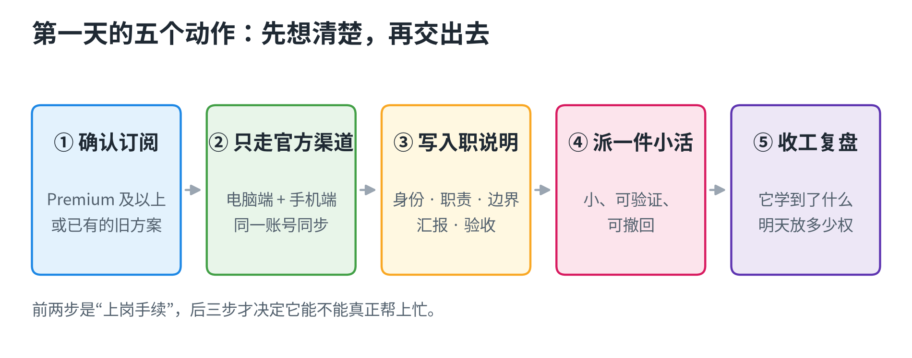
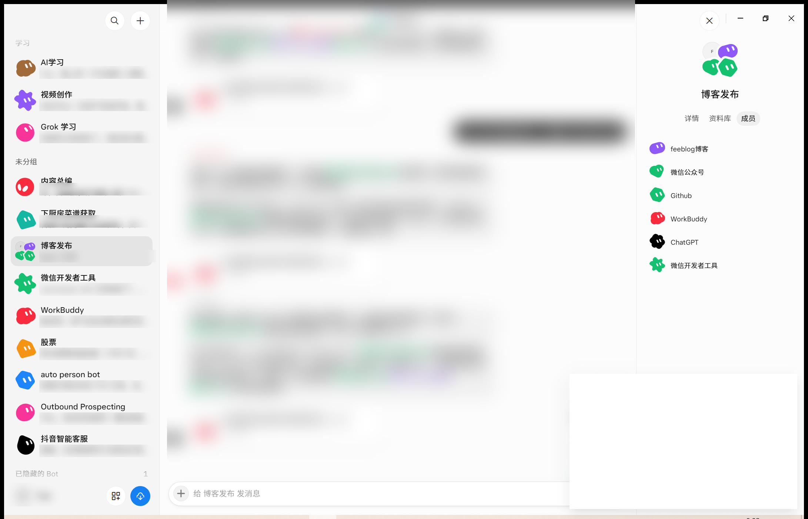
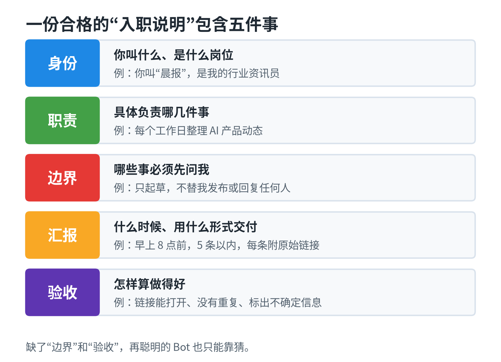
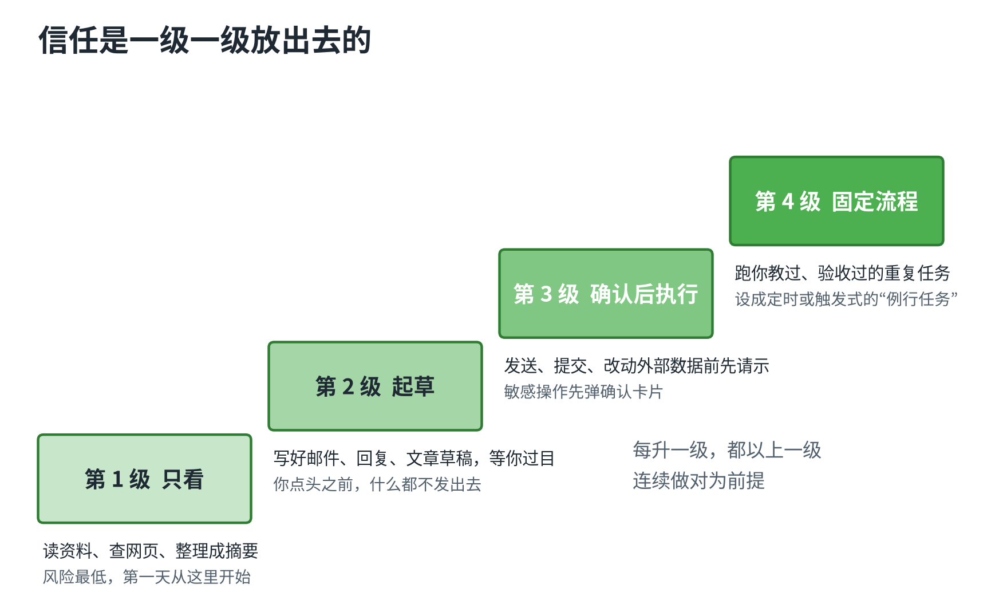

# Grok Bot Day 1 Checklist · 上手第一天操作手册

> 📚 [系列首页](../README.md) · 「Grok Bot 上手」系列：**第 1 篇（本文）：第一天给它办入职** → [第 2 篇：让它每天早上主动来「站会」](../day2-morning-briefing/README.md) → [第 3 篇：回信与排会议](../day3-reply-and-calendar/README.md) → [第 4 篇：专职店长](../day4-shop-manager/README.md) → [第 5 篇：群组协作](../day5-group-collaboration/README.md)

> 装好 Grok Bot 之后，第一天最该做的不是聊天，是给它办入职。
> 这是一份可以照着走的操作手册：前置条件 → 五个步骤 → 入职说明模板（中 / 英）→ 收工检查清单。

 

**为什么这么做？** Grok Bot 有自己的云端电脑，会跨对话记住你，你离开后也能继续干活。所以用它更像带一个新同事，而不是用一个更聪明的搜索框。第一天的重点只有三件事：写清岗位和边界，派一件能验收的小活，然后一级一级放权。



## 目录

- [0. 前置条件](#0-前置条件)
- [1. 核对订阅档位](#1-核对订阅档位)
- [2. 只从官方渠道安装](#2-只从官方渠道安装)
- [3. 定下数据边界](#3-定下数据边界)
- [4. 发出入职说明（模板）](#4-发出入职说明模板)
- [5. 派第一件任务](#5-派第一件任务)
- [6. 按四级放权](#6-按四级放权)
- [7. 收工检查清单](#7-收工检查清单)
- [参考资料](#参考资料)

---

## 0. 前置条件

| 项目 | 要求 |
| --- | --- |
| 订阅 | The X Subscription **Premium 及以上**（Plus 不含 Grok Bot） |
| 设备 | 电脑一台（macOS / Windows / Linux），建议再加一部手机 |
| 时间 | 第一天约 1–2 小时 |
| 版本 | 想用「导入记忆」和「权限」设置，需要 **0.75.2 及以上**版本 |

## 1. 核对订阅档位

Grok Bot 没有免费档。2026 年 10 月起，新用户统一走 The X Subscription（价格为美元、月付、不含税）：

| 档位 | 月费 | 包含 Grok Bot | 共享用量（以 Plus 为 1 倍） |
| --- | --- | --- | --- |
| Free | 0 | ❌ | 有限 |
| Plus | 8 | ❌ | 1× |
| Premium | 30 | ✅ | 4× |
| Super | 100 | ✅ | 15× |
| Ultra | 200 | ✅ | 50× |

> [!IMPORTANT]
> - **用量是共享的，每周刷新一次。** Grok 聊天、生图、Grok Bot 和 Cursor 共用同一个额度，Cursor 用得多，Bot 能用的就少。
> - **老用户不必马上切换。** SuperGrok、Cursor 付费方案、X Premium 可以继续用，但**合并账户一旦完成就无法撤销**。
> - **价格以下单时 [x.ai/pricing](https://x.ai/pricing) 为准。**

建议：先选 Premium，用一两周后在「用量与账单」里看实际消耗，再决定要不要升级。

## 2. 只从官方渠道安装

| 平台 | 渠道 |
| --- | --- |
| macOS / Windows / Linux（.deb、RPM、AppImage） | [cursor.com/download/bot](https://cursor.com/download/bot) |
| iPhone / iPad | App Store |
| Android | [Google Play](https://play.google.com/store/apps/details?id=ai.x.grok.bot)，2026-09-02 上线 |

- [ ] 从 [x.ai/bot](https://x.ai/bot) 跳转，或者在应用商店核对开发者信息后再装，避开名字相近的山寨应用。
- [ ] 电脑和手机登录同一个账号，同一个 Bot、同一段对话会两边同步。

> 关于 Android 的系统要求：有媒体报道写需要 Android 9 及以上，官方页面没有直接写明。

## 3. 定下数据边界

Bot 能登录你的账号，就真能替你发邮件、交表单。官方提供的保护有这些：

- 云端电脑在传输和存储时都加密，也可以设置不让数据用于训练；
- 敏感操作执行前会经过 **Auto-review（自动审核）**，拿不准的动作会弹出确认卡片，等你点头；
- 设置里有「**权限**」分区，可以把某类操作设成「总是先问我」或「无需询问」。

- [ ] 写下一条底线：哪些事它可以自己做，哪些必须先问你。下一步会把它写进入职说明的「边界」里。

## 4. 发出入职说明（模板）



*作者自己的 Grok Bot 电脑端界面，对话内容和个人信息已打码。左边是按分组排列的多个 Bot，右边是一个多 Bot 群聊的成员列表。*

装好后系统会先建一个「主 Bot」，头像上带一颗星，以后适合让它做统筹。起名、换头像都可以，但真正影响它后面表现的，是你发给它的第一段话。这段话要写清五个要素：



| 要素 | 写什么 | 好 / 差的例子 |
| --- | --- | --- |
| 身份 | 名字和岗位，名字最好能看出职能 | 「晨报」✅ ／「小助手」❌ |
| 职责 | 写具体动作，不写形容词 | 「每个工作日整理 AI 产品动态」✅ ／「帮我关注行业」❌ |
| 边界 | 哪些事必须先问你（**最重要**） | 「不替我发布、不回复任何人」 |
| 汇报 | 交付时间、篇幅、格式 | 「北京时间 8 点前，不超过 5 条」 |
| 验收 | 怎样才算做得好 | 「链接能打开、不重复、拿不准的标待核实」 |

### 中文模板（复制后改成你自己的）

```text
从今天起，你叫“晨报”，是我的行业资讯员。

你的职责：
1. 每个工作日早上，整理前一天 AI 产品领域值得关注的动态；
2. 优先看官方博客、更新日志和权威媒体，社交平台上的说法要注明来源和可信度。

你的边界：
- 只整理和起草，不替我在任何平台发布内容，也不回复任何人；
- 需要注册账号或付费才能看的内容，先问我。

汇报方式：
- 北京时间早上 8 点前发给我，不超过 5 条；
- 每条一句话概括，加一句“为什么值得关注”，附原始链接。

验收标准：
- 链接都能打开，不重复，拿不准的信息标“待核实”。
```

### English template

```text
From today, your name is "Morning Brief" and you are my industry news researcher.

Your responsibilities:
1. Every weekday morning, collect the AI product news from the previous day that is worth my attention.
2. Prefer official blogs, changelogs and reputable media. For claims from social platforms, note the source and how reliable it is.

Your boundaries:
- Only collect and draft. Never publish anything on any platform for me, and never reply to anyone.
- Ask me first before anything that needs a new account sign-up or a payment to read.

How to report:
- Send it to me before 8:00 AM (my local time), no more than 5 items.
- One sentence per item, plus one line on why it matters, with the original link.

Acceptance criteria:
- Every link opens, no duplicates, and anything uncertain is marked "to be verified".
```

> [!TIP]
> - 主要用来处理邮件的话，可以参考官方应用介绍里「收件箱管家」的定位：分拣邮件、标出紧急的、起草回复，**没有你同意绝不发送**。按五要素展开写就行。
> - 个人 Bot 在一次对话里记住的东西，在其他对话里也会记得。以前在别的 AI 助手里攒下的偏好，可以用设置里的「**导入记忆**（Import Memory）」带进主 Bot，这个功能需要 0.75.2 及以上版本。

## 5. 派第一件任务

第一件任务要满足三条：**小**（一小时内出结果）、**可验证**（你能很快判断对错）、**可撤回**（做错了也不会造成收不回的后果）。

| ❌ 不适合当第一件 | ✅ 更适合当第一件 |
| --- | --- |
| 帮我把所有未读邮件都回了 | 把最近三天的未读邮件按紧急程度分成三类，列给我看 |
| 帮我在小红书发一篇文章 | 根据我给的三个链接，起草一篇 800 字的初稿 |
| 帮我订下周去上海的机票 | 查下周二北京到上海上午的航班，列出时间和价格对比 |
| 帮我管理所有社交账号 | 统计我上个月发过的内容，按主题归类 |

左边那列不是做不到，是第一天就交出去，出错的代价是真实的：发错的邮件、已经付掉的钱、公开了的帖子。右边那列做得再差，也只浪费你几分钟。

- [ ] 它干活的时候，打开它的「电脑」看看它在操作什么。遇到需要登录的网站，它会停下来请你处理。

## 6. 按四级放权



| 级别 | 名称 | 它能做什么 | 什么时候用 |
| --- | --- | --- | --- |
| 1 | 只看 | 读资料、查网页、整理摘要 | 第一天 |
| 2 | 起草 | 写邮件、回复、初稿，发不发由你决定 | 第一级做稳以后 |
| 3 | 确认后执行 | 发送、提交、改外部数据，每次先弹卡片请示你 | 起草连续几次都做对以后 |
| 4 | 固定流程 | 把验证过的重复工作变成例行任务（routine），按时间或事件自动跑 | 第二、三周以后 |

**升级规则：** 上一级连续几次都做对了，再升一级。

到第 4 级可以试试演示学习：你自己做某件重复工作时，让 Bot 在旁边「跟着看」，它会把步骤存成例行任务，下次自己跑，你纠正过的地方它也会记住。

## 7. 收工检查清单

复制到 Issue 或笔记里，逐项打勾：

```markdown
- [ ] 确认过订阅档位，知道在「用量与账单」里看剩余额度
- [ ] 电脑和手机都装好了，登录的是同一个账号
- [ ] 入职说明已经发出，五个要素都写了，尤其是「边界」
- [ ] 第一件任务已经交付，按验收标准检查过
- [ ] 问过它今天记住了哪些关于我的偏好，记错的当场纠正了
- [ ] 想好了明天派什么活，以及权限停在第几级
```

> 最后一项最容易忽略。每天给一点反馈、每次多放一点权，决定了一个月后它是得力帮手，还是又一个装了不用的应用。

---

## 参考资料

**官方**

- [Grok Bot 官方介绍页（功能、隐私与数据 FAQ）](https://x.ai/bot)
- [Introducing Grok Bot（官方发布文章）](https://x.ai/news/introducing-grok-bot)
- [Grok Bot 更新日志](https://x.ai/changelog/bot)
- [The X Subscription 价格文档](https://docs.x.ai/x-subscription/pricing)
- [Grok Bot on The X Subscription（共享周用量、切换说明、合并不可撤销）](https://docs.x.ai/x-subscription/grok-bot)
- [官方价格页](https://x.ai/pricing)
- [Introducing The X Subscription](https://x.ai/news/x-subscription)
- [电脑端官方下载页](https://cursor.com/download/bot)
- [Google Play 上的 Grok Bot](https://play.google.com/store/apps/details?id=ai.x.grok.bot)
- [Cursor 论坛：Grok Bot is Now Live on Android（2026-09-02）](https://forum.cursor.com/t/grok-bot-is-now-live-on-android/170384)

**媒体**

- [TechCrunch：SpaceXSI bundles X Premium, Grok, and Cursor into one subscription（2026-10-13）](https://techcrunch.com/2026/10/13/spacexsi-bundles-x-premium-grok-and-cursor-into-one-subscription/)
- [The Tech Outlook：Grok Bot is now available on Android](https://www.thetechoutlook.com/new-release/software-apps/grok-bot-is-now-available-on-android/)

> 时效提示：价格和用量倍数按 2026-10 的官方文档整理；界面元素在不同版本里位置可能不一样，所以本文只描述功能，不写按钮位置。发布或使用前，请再核对一次官方页面。

---

**下一篇** 👉 [第 2 天：让 Grok Bot 每天早上主动来跟你「站会」](../day2-morning-briefing/README.md)

<sub>by Fee · 配图为自制示意图和本人界面截图（已打码）</sub>
