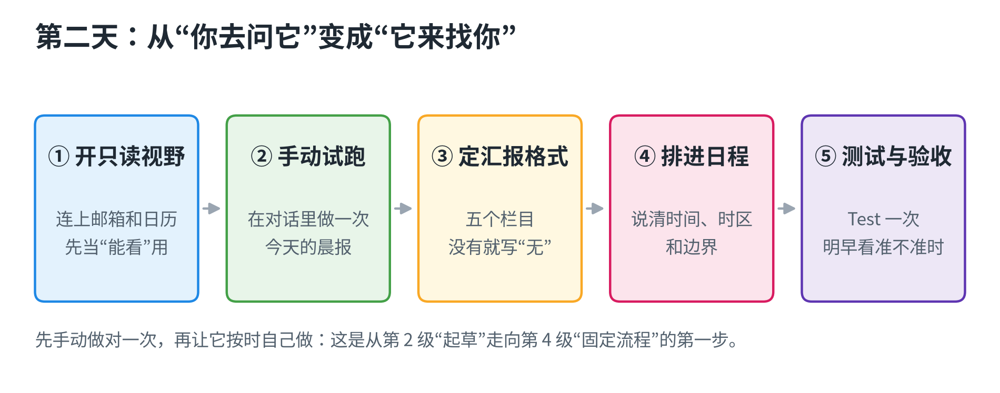
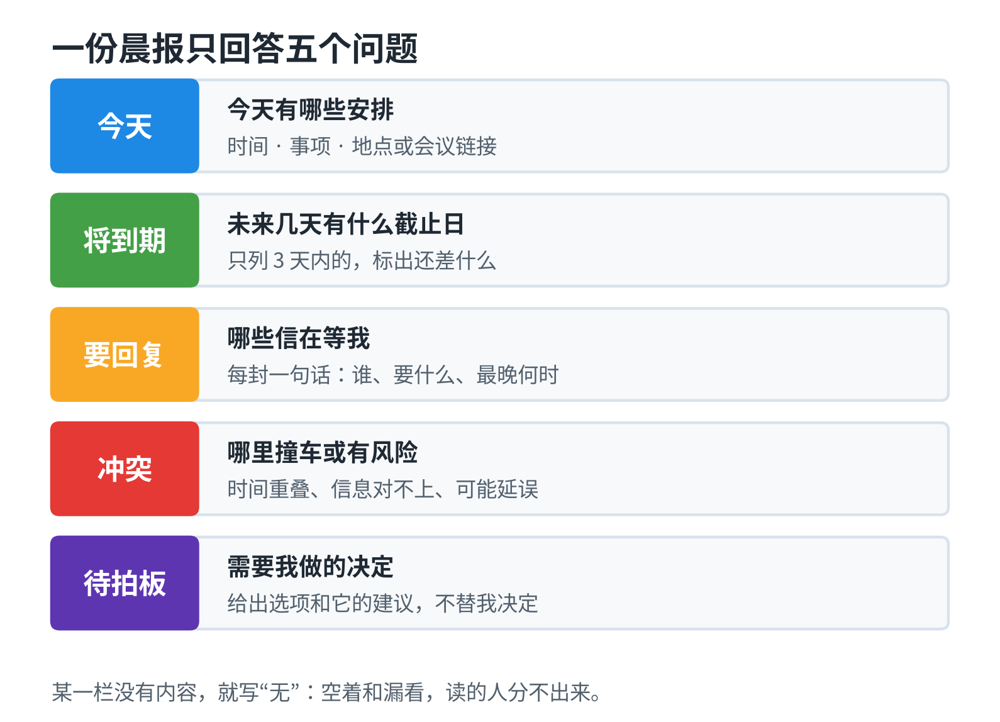
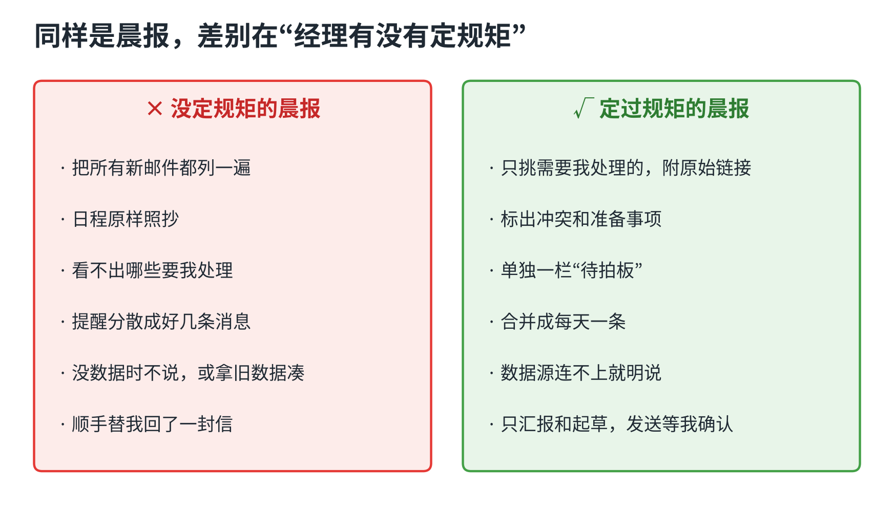

# Grok Bot Day 2 · 每日晨报操作手册

> 📚 [系列首页](../README.md) · 「Grok Bot 上手」系列：[第 1 篇：第一天给它办入职](../day1-checklist/README.md) → **第 2 篇（本文）：让它每天早上主动来「站会」** → [第 3 篇：回信与排会议](../day3-reply-and-calendar/README.md) → [第 4 篇：专职店长](../day4-shop-manager/README.md) → [第 5 篇：群组协作](../day5-group-collaboration/README.md)

 

**第二天要练什么？** 让 Bot 从「等你问」变成「主动来找你」。第一份主动汇报最适合是晨报，顺序也不能反过来：先给它看邮箱和日历的权限，在对话里手动做对一次，定好格式和边界，最后才排进每天的日程。先做对，再定时；先汇报，再动手。

这一天对应[第 1 篇](../day1-checklist/README.md)入职说明五要素里的「汇报」，也是四级放权里第一次从「起草」走到「固定流程」。



## 目录

- [0. 前置条件](#0-前置条件)
- [1. 连上 Gmail 和 Google 日历（只当「看」用）](#1-连上-gmail-和-google-日历只当看用)
- [2. 先在对话里手动试跑一次](#2-先在对话里手动试跑一次)
- [3. 定下晨报五栏格式](#3-定下晨报五栏格式)
- [4. 设成例行任务：说清六件事](#4-设成例行任务说清六件事)
- [5. 当天测试验收](#5-当天测试验收)
- [提示词模板（English）](#english-prompts)
- [参考资料](#参考资料)

---

## 0. 前置条件

| 项目 | 要求 |
| --- | --- |
| 第 1 天 | 已经给 Bot 发过入职说明，派过一件小活（见[第 1 篇](../day1-checklist/README.md)） |
| 账号 | 一个 Gmail 邮箱和 Google 日历 |
| 时区 | 设置里 Bot 分区下的 **Timezone** 要设成你想用的时区 |
| 时间 | 约 30–60 分钟，当天就能验收 |

## 1. 连上 Gmail 和 Google 日历（只当「看」用）

Grok Bot 通过「应用」（也就是连接器）对接这些服务。连接有两个入口：一是在侧边栏打开 **Connect apps** 搜索添加，二是直接在对话里说你要连什么，它会给你一张连接卡片。登录和授权都在服务商自己的页面上完成。

连上之后，它能做的不只是「看」：

| 应用 | 官方写明的能力 |
| --- | --- |
| Gmail | 搜索和阅读邮件、起草和发送、打标签。**一次只能连一个邮箱**，要换邮箱得先断开当前这个 |
| Google 日历 | 读取你能看到的日历、创建和修改日程、查空闲时间、回复邀请 |

> [!IMPORTANT]
> 能力是全的，但晨报只需要读。按第 1 天的四级放权，今天只开「只看」这一级。如果你有工作和私人两个邮箱，先连你最想被提醒的那一个。

把下面这段补进入职说明：

```text
从今天起你可以读我的 Gmail 和 Google 日历，用来整理晨报。
晨报只汇报，不回信、不改日程、不接受或拒绝任何邀请。
需要动手的事，列在“待拍板”里等我决定。
```

## 2. 先在对话里手动试跑一次

如果连完就直接说「每天 8 点发晨报」，你最早明天早上才能看到第一份，格式不对还得再等一天。官方的建议正好相反：先把一次性的任务做对，再把做法存下来，最后才自动化。

```text
现在帮我做一份今天的晨报试试：
看我今天和未来 3 天的日历，以及最近 24 小时的邮件，
告诉我今天要做什么、有什么快到期、哪些信在等我回复。
每一条都附上原始邮件或日程的链接。
```

拿到结果后逐条挑毛病，有问题就让它改完重做：

- [ ] 有没有漏掉你知道的重要会议？
- [ ] 有没有把广告、通知类邮件当成「要回复」？
- [ ] 每一条能不能点回原始邮件或日程核对？
- [ ] 有没有把不确定的事说成确定的？

Bot 会记住你纠正过的地方，下次就不用再讲一遍。

## 3. 定下晨报五栏格式



| # | 栏目 | 写什么 |
| --- | --- | --- |
| 1 | 今天 | 今天的安排：时间、事项、地点或会议链接 |
| 2 | 将到期 | 未来几天的截止日，还差什么没准备 |
| 3 | 要回复 | 哪些信在等你：谁、要什么、最晚什么时候 |
| 4 | 冲突 | 时间撞车、信息对不上、可能延误的地方 |
| 5 | 待拍板 | 需要你做的决定，它可以给选项和建议，但不替你决定 |

**两条规矩：**

1. **某一栏没有内容就写「无」，不能省掉。** 省掉了，你分不清是「今天确实没有」还是「它没看到」。
2. **「待拍板」是晨报和第 3 天之间的接口。** 它发现要回的信、要改的会，先列在这里，你点头后它才去起草。这样「主动」和「越权」就分开了。

```text
以后的晨报都按这五栏写：今天 / 将到期 / 要回复 / 冲突 / 待拍板。
某栏没有内容就写“无”。每条附原始链接。
全文控制在手机一屏能看完。
```



## 4. 设成例行任务：说清六件事

例行任务（routine）就是让一个 Bot 按时间表或某个事件（比如一封邮件、一条 Slack 消息）去做一件事。它在云端运行，你合上笔记本也照样会跑。直接在对话里用大白话交代就行，但创建时要说清这六件事：

| 要说清的事 | 晨报里怎么写 |
| --- | --- |
| 谁负责 | 在哪个 Bot 的对话里说，就是哪个 Bot 负责 |
| 时间和时区 | 每个工作日早上 8 点，北京时间 |
| 数据来源 | 我的 Gmail 和 Google 日历 |
| 交付什么 | 按五栏格式，发在这个对话里 |
| 边界 | 只汇报，不回信、不改日程 |
| 数据缺失时 | 邮箱或日历连不上就直接说，不拿旧数据凑 |

```text
把晨报设成例行任务：每个工作日早上 8 点（北京时间），
读我的 Gmail 和 Google 日历，按五栏格式发在这个对话里。
只汇报，不回信、不改日程、不回复邀请。
如果邮箱或日历连不上，直接告诉我，不要用旧数据。
```

> [!WARNING]
> **常见的坑**
> - **时区**：例行任务按设置里 Bot 分区下的 **Timezone** 来跑，默认跟随电脑自动识别。设完打开这个例行任务，看「**When to run**」里的时间对不对。
> - **第一次运行**：新建的例行任务要等到下一个预定时间才会跑。比如 8:05 才设「每天 8 点」，第一次就是明天早上。想当天看效果就用 Test。
> - **用量**：每跑一次都会消耗共享的每周用量（Grok、Grok Bot、Cursor 共用一个池子）。一天跑一次没压力，改成每小时一次就会很快用完。
> - **别重复**：之前已经设过的提醒，比如「截止日前三天提醒我」，可以让它合并进晨报，早上只收一条。

## 5. 当天测试验收

在电脑端打开这个例行任务，点 **Test**，它会马上跑一次，结果出现在 Bot 的对话里。有的例行任务没有 Test 按钮，那就在对话里让它按同样的要求现场做一次。

> [!CAUTION]
> 测试运行做的是真事，会访问网站、调用已连接的应用。测试前先确认边界已经写进交代里。

复制到 Issue 或笔记里逐项打勾：

```markdown
- [ ] 五个栏目都在，没有内容的那一栏写了「无」
- [ ] 每一条都能点回原始邮件或日程
- [ ] 没有任何邮件被回复，没有任何日程被改动
- [ ] 例行任务里显示的时间和时区和我要的一致
- [ ] 知道怎么暂停：在 Bot 详情里找到这个例行任务，可以暂停、编辑、删除，也可以直接在对话里跟它说
```

> [!TIP]
> 按官方更新日志，例行任务里出现的邮件和 Slack 消息会以**草稿**形式等你确认，不会直接发出去。但这只是兜底，边界还是要自己写清楚。

**过关标准：** 明天早上 8 点它准时来找你，五个栏目也都对。

---

<a id="english-prompts"></a>

## English prompts

```text
# Grant read-only scope
From today you may read my Gmail and Google Calendar to prepare a morning briefing.
The briefing only reports. Do not reply to email, change events, or accept or decline invites.
Anything that needs action goes under "Needs my decision" for me to decide.

# Manual trial run
Make me a trial briefing for today:
look at my calendar for today and the next 3 days, plus email from the last 24 hours.
Tell me what I need to do today, what is due soon, and which emails are waiting on my reply.
Attach the link to the original email or event for every item.

# Fix the format
From now on, write every briefing in five sections:
Today / Due soon / Needs reply / Conflicts / Needs my decision.
If a section is empty, write "None". Link every item to its source.
Keep the whole briefing short enough to read on one phone screen.

# Make it a routine
Turn the briefing into a routine: every weekday at 8:00 AM (my timezone),
read my Gmail and Google Calendar and post the five-section briefing in this chat.
Report only. Do not reply to email, change events, or respond to invites.
If Gmail or Calendar can't be reached, tell me directly instead of using old data.
```

---

## 参考资料

**官方**

- [Skills and routines（创建例行任务、六项确认、时区、Test、管理、用量）](https://docs.x.ai/grok-bot/skills-routines-and-automations)
- [Use the computer and apps（Connect apps、Gmail 和日历的能力、一次只连一个 Gmail）](https://docs.x.ai/grok-bot/computer-and-apps)
- [Settings and notifications（Timezone 设置）](https://docs.x.ai/grok-bot/settings-and-notifications)
- [Get started（官方晨报示例）](https://docs.x.ai/grok-bot/get-started)
- [Grok Bot 更新日志（2026-10-23：例行任务中的发送以草稿等待）](https://x.ai/changelog/bot)
- [Introducing Grok Bot](https://x.ai/news/introducing-grok-bot)
- [Grok Bot 官方介绍页](https://x.ai/bot)
- [Cursor 帮助中心：Connect apps](https://cursor.com/help/grok-bot/connect-apps)

> 时效提示：按钮和菜单名称（Connect apps、Timezone、When to run、Test）以 2026-11 的官方文档为准，界面更新后可能会变，所以本文只描述功能。

---

**上一篇** 👈 [第 1 天：装好 Grok Bot 之后，第一天最该做的不是聊天，是给它办入职](../day1-checklist/README.md)

**下一篇** 👉 [第 3 天：让 Grok Bot 帮你回信和排会议，发送权还是你的](../day3-reply-and-calendar/README.md)

<sub>by Fee · 配图为自制示意图</sub>
