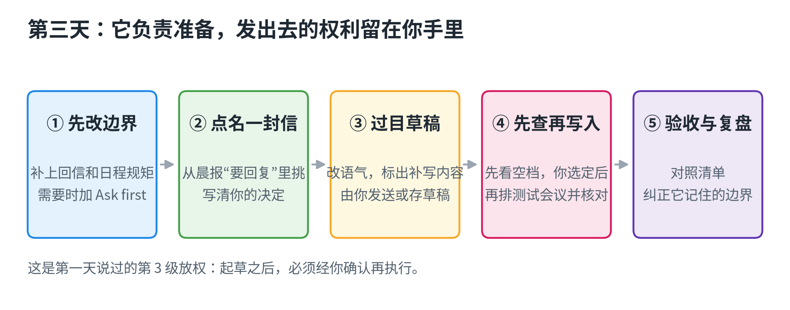
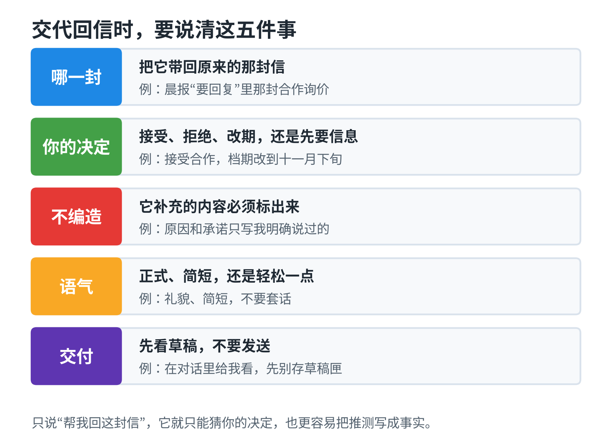
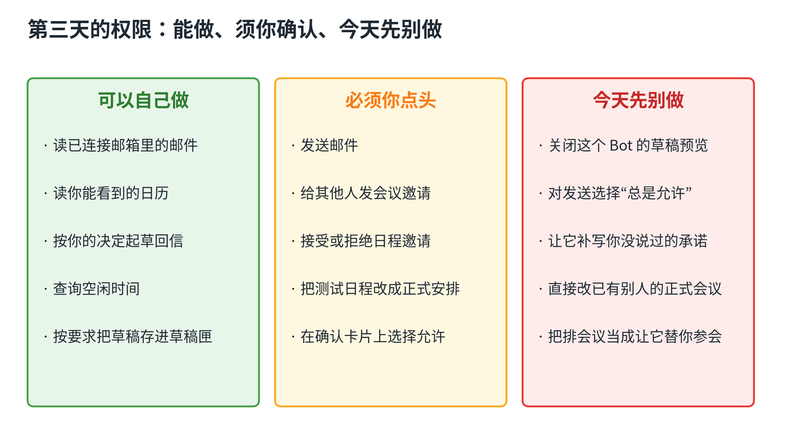

# Grok Bot Day 3 · 回信与排会议操作手册

> 📚 [系列首页](../README.md) · 「Grok Bot 上手」系列：[第 1 篇：第一天给它办入职](../day1-checklist/README.md) → [第 2 篇：让它每天早上主动来「站会」](../day2-morning-briefing/README.md) → **第 3 篇（本文）：回信与排会议** → [第 4 篇：专职店长](../day4-shop-manager/README.md) → [第 5 篇：群组协作](../day5-group-collaboration/README.md)

 

**第三天要练什么？** 把[第 2 篇](../day2-morning-briefing/README.md)晨报里的「要回复」和「待拍板」往前推一步：让它起草回信、查空档、按你选定的时间写入日历，但把「发出去」和「请别人来开会」的权利留在你手里。这对应[第 1 篇](../day1-checklist/README.md)四级放权里的第 3 级：**确认后执行**。回信和排会议都能动手，但风险不一样——信一旦发出就收不回；日程改起来容易，一旦加了其他人，改期或取消都会通知到别人。

顺序不能反过来：先改边界（必要时加上 Ask first 规则）→ 再起草回信，你过目后发送或存草稿 → 排会议先查空档，你选定后再写入 → 自己打开日历核对。



## 目录

- [0. 前置条件](#0-前置条件)
- [1. 先改边界，再动手](#1-先改边界再动手)
- [2. 回信：从「要回复」到一封你过目的草稿](#2-回信从要回复到一封你过目的草稿)
- [3. 排会议：先查空档，你选定后再写入](#3-排会议先查空档你选定后再写入)
- [4. 权限对照：能做、须你确认、今天先别做](#4-权限对照能做须你确认今天先别做)
- [5. 当天验收清单](#5-当天验收清单)
- [提示词模板（English）](#english-prompts)
- [参考资料](#参考资料)

---

## 0. 前置条件

| 项目 | 要求 |
| --- | --- |
| 第 1、2 天 | 已经写过入职说明，并设好每日晨报（见[第 1 篇](../day1-checklist/README.md)、[第 2 篇](../day2-morning-briefing/README.md)） |
| 账号 | 已连接一个 Gmail（**一次只能连一个邮箱**）和 Google 日历 |
| 练习材料 | 晨报「要回复」里有一封真实的信；另准备一场**没有其他参会人**的测试会议 |
| 时间 | 约 30–60 分钟，当天就能验收 |

## 1. 先改边界，再动手

新同事能看资料、能交晨报，不代表就可以对外发言。回信和排会议会碰到真实的人，规则要先写进入职说明，再派活。

在第 2 天那条「只汇报，不动手」后面，补上今天的授权范围：

```text
从今天起，你可以起草邮件、查看空闲时间，并在我确认后创建或修改测试日程。

回信的边界：
- 先在对话里给我看草稿，不要发送；
- 你补充的原因、日期或承诺，必须单独标出来，没经我确认不要写进正文；
- 需要发出去时，等我在草稿卡片上点发送，或按我的要求存进 Gmail 草稿匣，由我自己发送。

日程的边界：
- 先列出空档，不要一上来就创建事件；
- 今天只处理我明确指定的测试日程，不要接受或拒绝任何邀请，也不要给其他人发邀请；
- 改完之后把活动链接给我，我自己打开日历核对。
```

官方把对外发信设计成「默认先出草稿」：Bot 为你准备邮件或 Slack 消息时，对话里会出现一张可编辑的草稿卡片，上面标着 **Needs approval**（需要审批）。你先核对收件人、主旨和正文，再选 **Send**（发送）或 **Discard**（丢弃）。

> [!IMPORTANT]
> 这是默认行为，不是物理锁，不要把它说成「绝对不会发信」。官方写明，你可以在某张草稿卡片的菜单里选择 **Disable drafts for Bot**（关闭该 Bot 的草稿），之后它就会直接发送，只受 Auto Review（自动审核）约束。这个选项只对这个 Bot 生效，也只有所有者能看到。**第三天不要开它。**

更稳妥的做法，是再加一条自己的规则：打开 **Settings → General**，在 Bot 分区下找到 **Custom Rules**（自定义规则），用大白话写一条动作，并选 **Ask first**（先问我）。官方自己举的例子就是：在发送任何外部邮件之前先询问。Ask first 规则会拦住匹配的动作，弹出确认卡片；它和「允许自动执行」的规则同时命中时，以 Ask first 为准。Auto Review 默认是打开的（若管理员强制打开，用户关不掉）。

还要分清两件事：

| 场景 | 实际会发生什么 |
| --- | --- |
| 已连接的 Gmail 或 Outlook | 默认先出草稿卡片，等你过目 |
| Bot 自己的邮箱地址 | 你在对话里明确要求发一封信时，Auto Review 放行后它就可以发出去；审核需要你点头时，会先出现确认卡片 |
| 例行任务、外来消息，或不是你在这轮对话里提出的发送 | 会先以草稿等待，直到你按发送 |
| 转发，以及自动审核无法完整阅读附件的邮件 | 必须等你确认 |

所以边界还是要自己写。系统给的是一层默认保护，不是可以把入职说明删掉的理由。

## 2. 回信：从「要回复」到一封你过目的草稿

优先用晨报「要回复」里的那几封：你已经看过摘要，也知道大概要什么。交代时不要只说「帮我回这封信」，至少说清五件事：



| # | 要说清的事 | 写什么 |
| --- | --- | --- |
| 1 | 哪一封 | 点名发件人或主题，最好让它能回到原线程 |
| 2 | 你的决定 | 接受、拒绝、改期，还是先要更多信息，别让它替你判断 |
| 3 | 不能编造的事实 | 档期、报价、承诺，只允许写你明确说过的 |
| 4 | 语气 | 正式、简短，还是轻松一点 |
| 5 | 交付方式 | 先在对话里看草稿，不要发送，也不要提前存进草稿匣 |

```text
晨报“要回复”里那封【点名对方或主题】，按下面的决定帮我拟回信：
- 决定：【例如：接受合作，档期改到十一月下旬】
- 语气：【例如：礼貌、简短，不要套话】
- 事实：只写我明确说过的内容；你补充的原因、日期或承诺，请单独标出来

先在对话里给我看草稿，不要发送，也不要存进草稿匣，等我过目。
```

草稿出来后，先核对三样：收件人是不是原线程里的人，主旨有没有偏，正文有没有写成你没答应过的事。Gmail 的草稿卡片会在正文下方显示你账号里的签名；如果把草稿存进 Gmail，签名也会保留，Bot 不会再另写一套结尾致敬。有附件时，卡片上会列出文件，发送时一并带上；如果出卡片之后文件又被改过，这次不会发出去，卡片会重新打开让你再看一遍。

不满意就指出具体问题，而不是笼统地说「写得更好」：

```text
语气再收一点，删掉开头的客套。
你补上的改期原因如果不是我说的，请改掉，或标成“待我确认”，不要写成既成事实。
```

过目之后，选一条出路走完，不要两条都走：

- 你在对话的草稿卡片上点发送。发出去的是你看过的那一版，责任在你。
- 或者告诉它：这版可以，请存进我 Gmail 的草稿匣，接在原邮件下面，不要点发送。然后你自己打开 Gmail，再检查一次后发送。

> [!WARNING]
> 如果先存进了草稿匣，就不要再去点对话里那张卡片的发送，以免同一封信走出去两次。这不是官方单独列出的警告，而是同时操作两个入口时很容易发生的事。
>
> Gmail 一次只连一个邮箱，今天回信也是在同一个已连接的邮箱里完成。

## 3. 排会议：先查空档，你选定后再写入

回信和排会议不要用同一套放手程度。信发出去就收不回；日程通常可以改，可一旦加了其他参会人，改期、取消都会通知到别人。所以第三天只拿一场**没有其他参会人**的测试会议来练。

已连接的 Google 日历，官方写明的能力是：读取你能看到的日历、创建和修改事件、查询空闲时间，并在你可编辑的日历上回复邀请。它**不能**更改 Google Meet 的设置（例如等候室或主持人控制），也**不能**通过 Google 的 Zoom 插件添加 Zoom 链接。如果需要 Zoom 链接，你要自己写进地点或描述，或者先在日历里建好事件，再让它改其他字段。

> [!IMPORTANT]
> 创建事件时会不会自动带上 Google Meet 链接，官方能力说明里没有单独写清楚。需要视频会议时，请明确说出来，创建后再自己打开日历确认，不要默认「它一定带了」或「它一定没带」。
>
> 也不要把「帮你在日历上排一场会」和「让 Bot 进会做记录」混在一起。按 2026 年 11 月 11 日的更新日志，Bot 从链接加入 Google Meet、Zoom 或 Microsoft Teams 通话、在会议聊天里回答并在会后发摘要，目前适用于 Team、Enterprise 和 Ultra 方案。那是另一项能力，不是今天要练的。

建议按「先看、你选、再写、你核对」四步来。

先只查空档，不创建任何事件：

```text
看一下我【明天或指定日期】的日历，列出下午还没有被占用的 30 分钟空档。
先不要创建任何日程，也不要邀请任何人。
```

你选定一个时间后，再让它写入，并且先只加你自己：

```text
把“【测试】第 3 天日程练习”排在【你选定的日期和时间】，时长 30 分钟，只加我自己。
创建后把活动链接给我，我自己打开核对。
```

打开日历后，确认时间、标题、是否误加了其他人。要改时间或提醒，直接说即可：

```text
把这场测试会议改到【新的时间】，提前提醒改成开始前 10 分钟。
改完再把活动链接给我。
```

官方列出的日历能力是创建和修改事件，没有单独写「删除」。练完之后，请它取消或删除这场测试会议，然后**自己打开日历确认**事件已经不在。取消前再看一眼：里面没有其他参会人，标题也确实是刚才那一场。涉及删除或覆盖数据的动作，官方建议在交代时写明边界；今天这类测试，更应该你自己做最后确认。

## 4. 权限对照：能做、须你确认、今天先别做



| 类别 | 具体事项 |
| --- | --- |
| 可以让它自己做 | 读已连接邮箱里的邮件；读你能看到的日历；按你指定的线程起草回信；查询空闲时间；把草稿按你的要求存进 Gmail 草稿匣 |
| 必须你点头，或由你亲自完成 | 发送邮件；给其他人发会议邀请；在你可编辑的日历上接受或拒绝邀请；把测试日程改成正式安排 |
| 今天先不要做 | 关闭该 Bot 的草稿预览；在发送类确认卡片上选 **Always allow**（总是允许）；让它在信里自行补上你没说过的原因或承诺；对已经有其他人的正式会议直接改期或取消；把「排会议」理解成「让 Bot 替你参会」 |

草稿卡片上的 Send，以及 Auto Review 弹出的确认，都是给你用的，不要养成不看内容就点 Allow 的习惯。官方也提醒：不要批准一个你说不清对象和后果的动作；拿不准就让它先解释，或先出草稿。

这张表的目的不是把 Bot 绑死，而是让第 3 级放权可执行。连续几天它都能按边界准备好、等到你确认再动，以后再考虑把某类低风险动作往前放一点。

## 5. 当天验收清单

第三天不必处理完整个收件箱。复制到 Issue 或笔记里逐项打勾：

```markdown
- [ ] 入职说明里已经补上今天的回信和日程边界；如有需要，Custom Rules 里也加了一条发送外部邮件前 Ask first 的规则
- [ ] 从晨报「要回复」里挑出一封真实的信，让它按我的决定拟了草稿；我核对过收件人、主旨和正文，并要求它标出自己补写的内容
- [ ] 这封信要么由我在草稿卡片上发送，要么已存进 Gmail 草稿匣并由我自己检查；没有在两个入口各点一次发送
- [ ] 用一场没有其他参会人的测试会议，走完「先查空档 → 我选定后再创建 → 修改 → 我打开日历核对 → 取消后再次确认」
- [ ] 没有关闭草稿预览，也没有对发送类动作选择 Always allow
```

如果某一条没过，不要靠把任务再说一遍来补。先问它：今天哪一步越界了，哪一句是它自己补的，下次该在哪停下来。纠正记忆，比再做一场测试更有用。

**过关标准：** 它按你的决定准备好了回信和测试日程，对外发出去或请别人来开会的那一下，仍然由你完成。

---

<a id="english-prompts"></a>

## English prompts

```text
# Update the boundaries
From today, you may draft emails, check my free time, and create or change a test event after I confirm.

Reply boundaries:
- Show me the draft in this chat first. Do not send.
- Any reason, date, or commitment you add must be marked separately and must not go into the body until I confirm it.
- When something needs to go out, wait for me to press Send on the draft card, or save it to my Gmail drafts if I ask, and I will send it myself.

Calendar boundaries:
- List open slots first. Do not create an event until I say so.
- Today, only handle the test event I name. Do not accept or decline invites, and do not invite anyone else.
- After a change, give me the event link so I can open the calendar and check it myself.

# Draft a reply
From the "Needs reply" section of the morning briefing, draft a reply to [name the sender or subject] with these decisions:
- Decision: [e.g. accept the collaboration, move the window to late November]
- Tone: [e.g. polite, short, no filler]
- Facts: only write what I have clearly said; mark any reason, date, or commitment you add

Show me the draft in this chat first. Do not send it, and do not save it to the drafts folder until I have reviewed it.

# Revise the draft
Tighten the tone and cut the opening pleasantries.
If the reason you added for the date change is not something I said, remove it, or mark it as "pending my confirmation". Do not present it as a fact.

# Check availability first
Look at my calendar for [tomorrow or a date I name] and list 30-minute slots that are still free in the afternoon.
Do not create any event, and do not invite anyone.

# Create the test event
Schedule "[Test] Day 3 calendar practice" at [the date and time I picked], 30 minutes, with only me as the attendee.
After you create it, give me the event link so I can open it and check.

# Change the test event
Move this test meeting to [new time], and change the reminder to 10 minutes before it starts.
Give me the event link again when you're done.
```

---

## 参考资料

**官方**

- [Message and collaborate（草稿卡片、Needs approval、可关闭草稿预览、非当轮请求以草稿等待）](https://docs.x.ai/grok-bot/chat-and-collaboration)
- [Approvals, security, and privacy（Auto Review、Custom Rules、Ask first、Bot 自有邮箱的发送规则）](https://docs.x.ai/grok-bot/approvals-security-and-privacy)
- [Use the computer and apps（Gmail 与日历能力、一次只连一个 Gmail、不能改 Meet 设置、不能通过插件加 Zoom 链接）](https://docs.x.ai/grok-bot/computer-and-apps)
- [Get started（收件箱管家示例）](https://docs.x.ai/grok-bot/get-started)
- [How Grok Bot works（Ask first 拦截发送邮件的示例）](https://docs.x.ai/grok-bot/how-grok-bot-works)
- [Settings and notifications](https://docs.x.ai/grok-bot/settings-and-notifications)
- [Add a Bot to Your Meetings（加入会议是单独能力，与在日历上排会议不同）](https://docs.x.ai/grok-bot/meetings)
- [Grok Bot 更新日志（2026-11-11：Team / Enterprise / Ultra 方案下 Bot 可加入 Meet、Zoom 或 Teams 通话）](https://x.ai/changelog/bot)
- [Grok Bot 官方介绍页](https://x.ai/bot)

> 时效提示：按钮和菜单名称（Needs approval、Disable drafts for Bot、Custom Rules、Ask first、Always allow）以 2026-11 的官方文档为准，界面更新后可能会变，所以本文只描述功能。创建事件是否自动附带 Google Meet 链接、以及删除日历事件，官方未单独写明，文中要求创建或取消后自己打开日历核对，不写成肯定或否定。

---

**上一篇** 👈 [第 2 天：让 Grok Bot 每天早上主动来跟你「站会」](../day2-morning-briefing/README.md)

**下一篇** 👉 [第 4 天：别把店务继续堆给同一位同事，请一位专职店长](../day4-shop-manager/README.md)

<sub>by Fee · 配图为自制示意图</sub>
