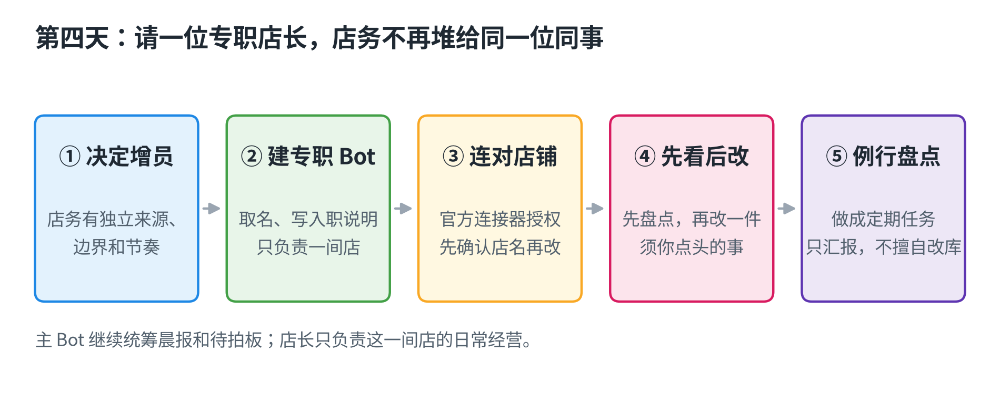
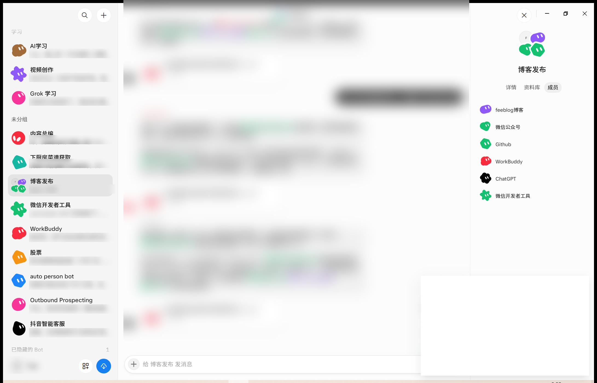
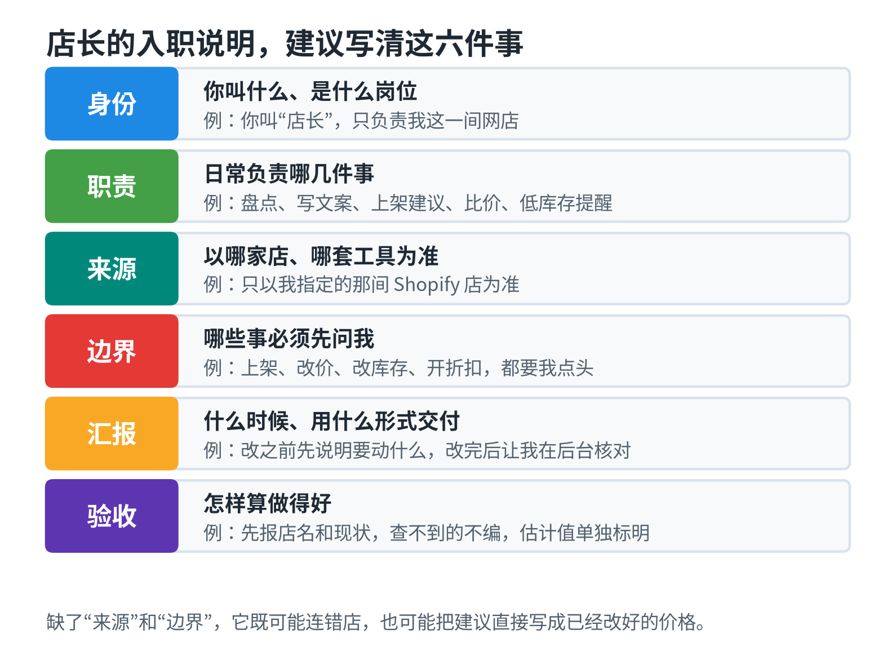
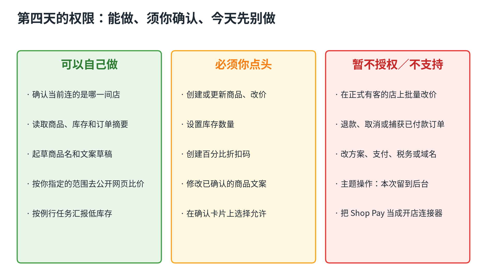

# Grok Bot Day 4 · 专职店长操作手册

> [系列首页](../README.md) · 「Grok Bot 上手」系列：[第 1 天：入职说明](../day1-checklist/README.md) · [第 2 天：每日晨报](../day2-morning-briefing/README.md) · [第 3 天：回信与排会议](../day3-reply-and-calendar/README.md) · **第 4 天：专职店长（本文）** · [第 5 天：群组协作](../day5-group-collaboration/README.md)
>
> 根据 2026-11-16 母稿改编；发布准备时再次核对 Shopify 连接器官方说明。模板中的商品、数字、代码均为占位示例，不是店铺实测结果。

延续第 1 天的入职说明和第 3 天的「确认后执行」：主 Bot 继续负责晨报、日常对接和待拍板，店长只负责指定的一间店。今天的完成线是确认连接正确、做一次只读盘点，经你批准后只改一件事，再由你打开后台验收。




## 目录

1. [前置条件](#1-前置条件)
2. [何时该增员](#2-何时该增员)
3. [新建与入职说明](#3-新建与入职说明)
4. [连接店铺与注意事项](#4-连接店铺与注意事项)
5. [先做只读盘点](#5-先做只读盘点)
6. [第一件改动：三类任务选一类](#6-第一件改动三类任务选一类)
7. [权限对照](#7-权限对照)
8. [把只读盘点设为例行任务](#8-把只读盘点设为例行任务)
9. [验收清单](#9-验收清单)
10. [配图说明与参考资料](#10-配图说明与参考资料)

## 1. 前置条件

| 项目 | 需要具备什么 |
| --- | --- |
| 主 Bot | 已完成前三天练习，知道哪些动作要先等你确认 |
| 店铺 | 优先使用没有真实顾客下单、允许练习改动的店；已有店须具备相应账号权限 |
| 数据 | 有自己确定的商品事实、价格或库存；没有的数据不能让它估完直接写入 |
| 验收入口 | 你能自己打开 Shopify 后台，对照它的结果逐项检查 |
| 使用范围 | 本手册是操作模板，不声称作者已完成授权、上架、改价或开折扣 |

尚未有店时，官方连接器支持在注册 Shopify 前按描述创建可预览店铺。未保存到账号的店默认有密码保护，顾客不能下单，但持有地址的人可以查看，也可能通过 AI 工具修改，链接只应分享给信任的人；预览链接约 30 分钟过期。保留或经营前按官方流程保存到你的 Shopify 账号，并核对适用方案。不要为了练习自动购买方案。

## 2. 何时该增员

下面三项同时出现，就适合拆出专职店长，而不是继续给主 Bot 加任务：

- 有独立资料来源，例如一间网店后台。
- 有单独审批边界，例如改价、上架、折扣都须店主点头。
- 有自己的重复节奏，例如每周低库存检查。

增员是分工，不是扩容。在 The X Subscription 下，Grok、Grok Bot 和 Cursor 共用每周用量，新 Bot 不会单独增加额度。每位 Bot 有自己的记忆；少量个人事实会共享，但店长的定价口径、盘点规则不应假设会自动进入主 Bot 的记忆。

> [!IMPORTANT]
> **岗位分开不等于权限隔离。** 同账号的 Bot 共享云端电脑、文件、浏览器登录态和已连接应用；各自的桌面不等于各有一台独立电脑。建立店长后，其他 Bot 并不会自动失去店铺访问能力。

## 3. 新建与入职说明

按母稿所引官方说明，可从侧边栏顶部的「+」新建 Bot，或使用 `Cmd/Ctrl+N`；团队账号可能先显示菜单。填写名称、选择头像形状与颜色，再创建。名称建议直观地写成「店长」，与主 Bot 区分。



*真实截图只展示侧边栏「+」入口及已有多位 Bot。对话内容和部分名称已脱敏；不是创建对话框，不是 Shopify 授权页，也不是店铺后台。*



第一句话写清岗位、来源与审批边界：

```text
你是我的店长，只负责我指定的这一间网店。

职责：查看商品和库存、起草商品文案、按我确认过的内容上架或改价、按我的要求准备折扣，以及定期提醒低库存。
来源：只以我指定、并完成授权的那一间 Shopify 店为准。每次动手前，先告诉我当前连的是哪一间店。
边界：
- 先看后改。没有我的确认，不要创建或更新商品，不要改价格或库存，不要开折扣，也不要改会展示给顾客的内容；
- 你补充的重量、产地、功效或价格，必须单独标成“待我确认”，不要写成既成事实；
- 公开网页上查不到的比价，就如实说没有查到，不要编数字。

先记住这些规矩。现在不要改任何东西，先告诉我：你还需要我补充哪几项，才能开始做一次只读盘点。
```

再补全汇报和验收要求，避免只有职责、没有交付标准：

```text
汇报：任何改动前先列出当前值、拟写入值和影响范围；完成后列出实际改了什么、哪些没有完成，并给我后台核对入口。
验收：先报当前店名；读不到的标明“未找到”；估计值单列。未经我确认不写入，不把建议写成已完成。
请记住这些规则。创建其他新 Bot 前也先问我，不要自行扩大分工。
```

## 4. 连接店铺与注意事项

1. 在 **Grok Bot** 的 Connect apps 搜索 Shopify，使用官方集成。
2. 到 Shopify 官方授权页面核对店铺和数据访问范围。只读权限只能查看，写权限才允许改动；员工账号本身的权限仍然有效。
3. 连接后让它回报当前店名，与自己在后台看到的核对。只在私下核对真实店名、域名等，不要把授权信息截图公开。
4. 一次只连一间店，即使这些店属于同一个组织。换店会断开当前连接、重新授权；**换店后开新对话**，避免旧对话继续请求旧店权限。

| 容易混淆的事情 | 正确理解 |
| --- | --- |
| Grok 已安装 Shopify 连接器 | 不代表 Grok Bot 已安装，须在 Grok Bot 里单独添加 |
| Shop Pay | 是购物结账钱包，不是 Shopify 商家连接器 |
| Shopify App Store | 这条连接器不从这里下载；不要为教程另建访问令牌或自搭集成 |
| 降低已经批准的权限 | Shopify 说明需先卸载集成，再按更小范围重新安装 |
| 店长有入职规则 | 不是系统层的账号隔离；必要时为改价、上架、折扣添加 Ask first 规则 |

Shopify 后台仍是管理生意的主阵地，连接器不替代后台或 Sidekick。本文没有创建对话框、授权卡、商品改动后的后台实拍，不以其他界面代替证据。

## 5. 先做只读盘点

先看清现状，不要连接成功就上架：

```text
先不要改任何商品。请确认当前连接的店名，然后只读盘点：
- 现有商品的名称、售价、库存（如有多地点，按地点列出）；
- 哪些商品缺图、缺 SKU，或库存偏低；
- 你建议我下一步先处理哪一件，理由是什么。

查不到的就标明“未找到”，不要编数字。盘点结束后明确告诉我：你改过什么——今天这一步的正确答案应当是“什么都没改”。
```

库存可以按地点、款式查看；顾客资料可按姓名、邮箱、地区或标签查找，但连接器不能修改顾客资料。公开文章不要发布盘点中的真实顾客、订单、邮箱或店铺敏感信息。

盘点验收先看三点：店是否正确，数字是否可从后台核实，是否确实没有写入。向它提任务时点名 Shopify，并确认本次对话已打开连接器；否则它可能只是给你操作说明，并没有实际执行。

## 6. 第一件改动：三类任务选一类

不要同一轮里上架、改价、开折扣、改主题。每次只提一件任务；正式写入前核对对象和影响范围。

### A. 商品文案与创建

```text
这是一件准备上架的新品。已知事实如下：【名称、材质、尺寸或重量、产地，只写你确定的】
请先起草：商品名、80 字以内的描述、建议售价和定价理由。
你估计或补充的内容，请单独标成“待我确认”。先不要在店里创建商品，等我过目。
```

你修改并确认后，再明确授权它创建指定商品。重量、产地、功效、价格没有依据就不能写成事实；提供的款式、标签、库存跟踪等细节也应原样执行，不让它自行补完。

图片有单独限制：连接器添加你自己的图，需要公开可访问的图片链接；从本地设备上传，应先把店保存到 Shopify 账号，再到后台上传。**在聊天里附图，不代表图片一定会出现在商品页。**

### B. 改价或更正库存

```text
请通过 Shopify 读取【商品标识】的当前价格或库存，先不要修改。
若为库存，请列出【指定地点】的当前数量。
我的拟改值是【我已核对的新值】，原因是【收货 / 更正 / 损坏等】。
请先对照当前值和拟改值，列出影响范围，等我确认后再执行。
执行后说明实际改动，给我后台核对入口，不要连带修改其他商品。
```

库存更新前连接器会先读数量；读后数量若又变化，更新会安全停止。不要估算库存后直接写入。需要市场比价时现查公开页面，写明来源与查阅时间；被登录或验证挡住就报告没查到，不能补一个合理数字。

### C. 百分比折扣码

```text
请准备一组百分比折扣码，先不要创建：
- 代码：【例如 WEEK10】
- 力度：【例如全店九折，即 10% off】
- 适用：【全店 / 某件商品 / 某个产品系列】
- 期限和对象：【开始和结束时间、是否所有顾客可用、是否有低消、是否限制使用次数】

请先列出你会写入的全部条件，等我确认后再创建。
```

连接器支持创建百分比折扣码，可针对全店、指定商品或产品系列，并带相应条件。它会要求确认开始日期和使用对象。

> [!WARNING]
> **不能修改已有折扣码，不能创建固定金额折扣。** 这两类去 Shopify 后台处理。模板里的代码、百分比、阈值、期限都是示例，不是给实际店铺的默认授权。

无论选哪种，执行后自己打开后台核对名称、价格、库存、描述、图片或折扣条件，并检查没有连带修改其他商品。Shopify 明确要求店主负责核对操作准确性。

## 7. 权限对照



> [!IMPORTANT]
> **配图适用范围：本次练习不含主题操作。** Shopify 同一页面前文写不能发布主题，后文及 `theme_publish` 工具表又写可在确认后发布，表述不一致。本文不据此判断是否支持发布；新版权限图已将主题操作留到后台，本文也排除该项练习，统一由店主到 Shopify 后台自行处理。

| 类别 | 今天的范围 |
| --- | --- |
| 可先做 | 确认店名；读取商品、库存、订单摘要和只读顾客信息；起草文案；有来源的公开比价；只读低库存报告 |
| 必须先确认 | 创建或更新指定商品；改价格、SKU；按地点设库存；创建百分比折扣码；其他对顾客可见的内容改动 |
| 后台自行处理或连接器不支持 | 退款；取消或捕获已付款订单；标为已付款；退货；创建或调整礼品卡；方案、支付、税务、域名设置；主题相关操作（本次练习统一留到后台，发布能力的官方说明有冲突） |
| 今天不要尝试 | 正式在售店批量上架或改价；关闭关键审批；对改价、上架选择 Always allow |

Auto Review 会检查即将执行的操作；匹配 Ask first 规则时要等确认。看清对象和后果再允许，不把「默认审核」理解成不会越界的物理锁。批量操作可能中断，未完成的到后台核实；例如商品上架、草稿或归档状态的批量修改一次最多 50 件。

## 8. 把只读盘点设为例行任务

先把一次盘点做对，需要时再保存方法，最后才定时。以下是可复制的**示例**，不是本文自动为读者创建的例行任务：

```text
从下周起，每个星期一上午 9:00（北京时间）做一次只读库存检查：
- 先确认当前连的是我指定的那间店；
- 列出库存低于【例如 5】件的商品，没有就不要打扰我；
- 只汇报，不要改库存、价格或上架状态；
- 如果连不上店，或读不到库存，就报告失败，不要用上次的旧数字凑数。
```

核对负责人是店长，不是主 Bot；时间、时区、缺数据时怎么办都写清楚。时区按设置中的 Timezone，想固定北京时间应明确指定 Asia/Shanghai，而不是只依赖电脑自动识别。

新例行任务要等到下一个预定时间，不会创建后立即执行。若周一 9:05 才设每周一 9:00，首次是下周一。可用 Test 当天检查，但 **Test 会做真实工作**，不要用它绕过写入审批；没有 Test 时，在对话里按相同只读要求试跑。

例行任务在云端运行，合上笔记本也会继续。母稿所引文档列出每位 Bot 最多 50 条例行任务、最小运行间隔五分钟；实际以当前官方说明和保存结果为准。每次运行消耗共享用量，可在 Bot 详情管理、暂停或删除。

## 9. 验收清单

```markdown
- [ ] 店长与主 Bot 的名称、职责可区分，入职说明包含来源与审批边界
- [ ] 在 Grok Bot 而不是只在 Grok 中添加了 Shopify，且没有混淆 Shop Pay
- [ ] 店长回报的当前店铺与后台一致；换店后已开新对话
- [ ] 做过一次只读盘点，缺数据如实标记，没有改动任何商品
- [ ] 只批准并执行一件明确改动，店主在后台核对过结果及影响范围
- [ ] 没有捏造商品事实、销量、价格、库存、比价或授权对话
- [ ] 如需定期巡检，例行任务是只读的，负责人、时区、失败处理均正确
- [ ] 没有关闭关键审批，也没有把专职分工误当作权限隔离
```

没通过时先追问：当前是哪间店、实际改了什么、哪些内容是它补的、下次应该在哪一步停下。不要重复发一次同样的写入指令来补救。

## 10. 配图说明与参考资料

本文使用五张母稿配图：三张自制流程或模板图、一张脱敏的真实 Grok Bot 侧边栏截图、一张自制情景插画。插画和示意图不是执行证据。没有借用参考文章配图，也没有把无关界面当作授权、上架或改价实拍。已采用新版权限图，主题操作不作为本次练习项目，官方表述冲突已在正文显著注明。

- [Create and manage Bots（新建 Bot：侧边栏 + 或 Cmd/Ctrl+N，填写名称并选择头像形状和颜色；第一句话写明工作、来源和审批边界；主 Bot 与专职 Bot；记忆范围与删除不可恢复）](https://docs.x.ai/grok-bot/bots)
- [How Grok Bot works（大多数 Bot 适合一件清楚的工作；主 Bot 负责对接和协调；当工作有独立来源、规则或时间表时再增员；价格等变动数字应现查；账号下电脑与登录态共享）](https://docs.x.ai/grok-bot/how-grok-bot-works)
- [Use the computer and apps（所有 Bot 共用同一台电脑和已连接账号；Shop Pay 是用于在 Shopify 店铺结账的钱包，与商家连接器不同）](https://docs.x.ai/grok-bot/computer-and-apps)
- [Skills and routines（先把一次性任务做准，再做成例行任务；时区、创建后等到下次预定时间才跑、Test 会执行真实工作；一位 Bot 最多 50 条例行任务）](https://docs.x.ai/grok-bot/skills-routines-and-automations)
- [Approvals, security, and privacy（Auto Review、Custom Rules、Ask first）](https://docs.x.ai/grok-bot/approvals-security-and-privacy)
- [Get started](https://docs.x.ai/grok-bot/get-started)
- [Grok Bot 官方介绍页（给每位 Bot 一份工作，工作增加时再添加）](https://x.ai/bot)
- [Grok Bot on The X Subscription（Grok Bot 包含在 Premium / Super / Ultra；用量来自 Grok、Grok Bot 和 Cursor 的共享周额度）](https://docs.x.ai/x-subscription/grok-bot)
- [Shopify connector for Grok（连接器在 Grok 与 Grok Bot 中均可使用，但 Grok 的连接器页面不会为 Grok Bot 安装；在 Grok Bot 中需于 Connect apps 搜索 Shopify；可管理商品、系列、库存、订单、顾客、折扣和分析；图片需公开链接或在后台上传；百分比折扣码的能力与限制；库存先读后写；换店后应开新对话）](https://help.shopify.com/en/manual/ai-powered-tools/connecting-ai-tools/shopify-connector-for-grok)
- [Authorizing AI tool access to your store（官方集成、不要自建 API 令牌；一次连一间店；只读与写权限；降低权限需先卸载再安装；换店流程）](https://help.shopify.com/en/manual/ai-powered-tools/connecting-ai-tools/authorizing-access)
- [Considerations for using third-party AI tools with your Shopify store（你负责核对准确性；连接器不能替代 Shopify 后台；退款和已付款订单、礼品卡、方案与支付、已发布主题等限制）](https://help.shopify.com/en/manual/ai-powered-tools/connecting-ai-tools/considerations)
- [Grok Bot 更新日志](https://x.ai/changelog/bot)


---

上一篇：[第 3 天：回信与排会议，确认后执行](../day3-reply-and-calendar/README.md)。

下一篇：[第 5 天：把总管和店长放进同一间会议室（系列收官）](../day5-group-collaboration/README.md)。

<sub>by Fee · 真实截图已脱敏，流程图和情景图为自制；本文不是店铺运营实测记录。</sub>
