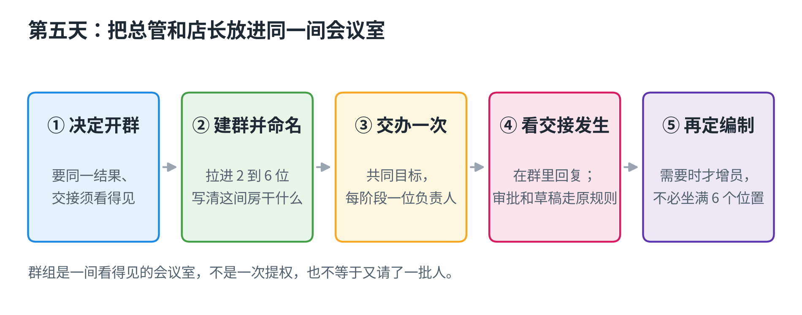
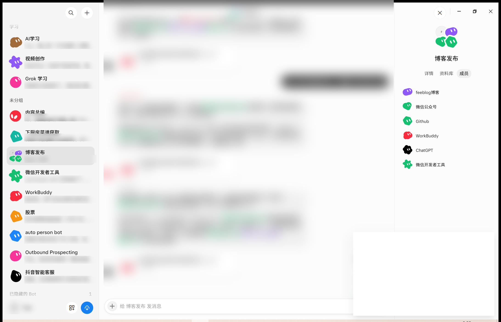
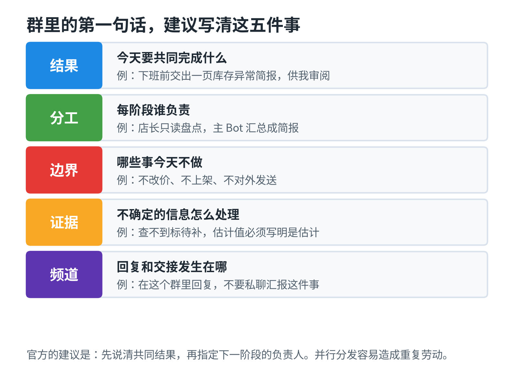
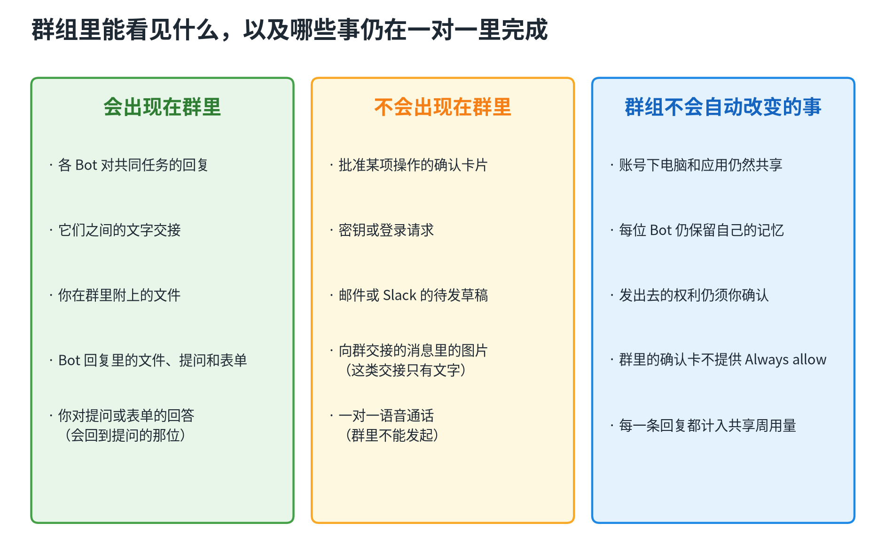

# Grok Bot Day 5 · 群组协作操作手册

> 📚 [系列首页](../README.md) · 「Grok Bot 上手」系列（五篇完结）：[第 1 篇：第一天给它办入职](../day1-checklist/README.md) → [第 2 篇：每日晨报](../day2-morning-briefing/README.md) → [第 3 篇：回信与排会议](../day3-reply-and-calendar/README.md) → [第 4 篇：专职店长](../day4-shop-manager/README.md) → **第 5 篇（本文）：群组协作**

  

**第五天要练什么？** 不是再请三到五位同事、把六个位置坐满，也不是当场发布短视频。把已经在岗的[主 Bot](../day1-checklist/README.md)和[专职店长](../day4-shop-manager/README.md)放进同一个群：给一个共同结果，每一阶段只指定一位负责人，让交接发生在你看得见的房间里。这是五天系列的收官，不再有第 6 天。

群组是会议室，不是一次提权，也不会自动隔开权限或合并记忆。批准操作的确认卡片、密钥或登录请求、邮件和 Slack 待发草稿，都不会出现在群里；发出去的权利，仍按[第 3 篇](../day3-reply-and-calendar/README.md)留在你手里。




## 目录

- [0. 前置条件](#0-前置条件)
- [1. 何时开群，而不是先增员](#1-何时开群而不是先增员)
- [2. 建立与命名](#2-建立与命名)
- [3. 交办模板：共同结果，每阶段一位负责人](#3-交办模板共同结果每阶段一位负责人)
- [4. 群里能看见与不能看见的事](#4-群里能看见与不能看见的事)
- [5. 权限与记忆](#5-权限与记忆)
- [6. 用量与语音限制](#6-用量与语音限制)
- [7. 何时再增员](#7-何时再增员)
- [8. 当天验收清单](#8-当天验收清单)
- [9. 五天方法回顾](#9-五天方法回顾)
- [提示词模板（English）](#english-prompts)
- [参考资料](#参考资料)

---

## 0. 前置条件

| 项目 | 要求 |
| --- | --- |
| 第 1–4 天 | 主 Bot 已办入职，晨报和「确认后执行」已经练过，并且请过一位专职店长或同等岗位的专职 Bot |
| 成员 | 今天只放已经在岗的两位，不要为了凑人数再请一批人 |
| 练习内容 | 一次只读协作，例如一页库存异常简报；不要改价、上架或对外发送 |
| 时间 | 约 30–60 分钟，当天就能验收 |

模板里的「店长」「主 Bot」只是占位，请换成你自己的名称。不要编造具体店铺、库存数字或对话记录。

## 1. 何时开群，而不是先增员

先用三个问题过滤，不要一上来就增员：

- 是不是已经有一个共同要完成的结果，而不是两件互不相干的私事？
- 是不是需要它们交接，而且你希望交接发生在能回看的地方？
- 是不是每位已经有自己的岗位，而不是靠把更多人拉进房间来补清职责？

如果第一位还在「什么都做一点」，先回到[第 4 篇](../day4-shop-manager/README.md)把岗位写清楚。如果店长的只读盘点还没有得到过你的认可，先不要让它在群里带动库存。群组不会自动补上入职说明，也不会自动加上权限隔离。

官方定位很明确：当几位 Bot 需要同一个结果，而且交接必须看得见时，再开一个群。群最多可以加入六位 Bot，但六是上限，不是今天的目标。

## 2. 建立与命名

群组不会因为你有了两位 Bot 就自动出现，要自己建。

**桌面端任选一种方式：**

1. 选择 **New chat**，或使用 `Cmd/Ctrl+Shift+N`；也可以按 `Cmd/Ctrl+K` 打开指令面板，选择 **New group chat**。注意：新建 Bot 的快捷键是 `Cmd/Ctrl+N`，和建群不是同一组按键。
2. 在 **To:** 字段里加入两位到六位 Bot。今天只加主 Bot 和店长就够了。
3. 进入群后，按需要改掉自动生成的名称。
4. 第一句话就说明：这个群要共同完成什么，下一阶段由谁负责。

在 iPhone 或 Android 上，入口是 **+ → New Group Chat**。群成员可以稍后修改。中文界面的译名可能与文档不完全一致，以你软件里实际看到的菜单为准。

给群改名时，桌面端可以在侧边栏里右键选择 **Rename chat**，或点开群名称再编辑；手机上点群名，再选 **Edit**，改完后点 **Done**。名称要写出这间房的用途，例如「店务周会」或「库存与简报」，不要取成「新群组 1」。若要改变这个群是干什么的，直接在群里告诉各位 Bot。

> [!NOTE]
> 你可以把同事分享给你的 Bot 加进群，但不能把它和运行在你自己电脑上的 Bot 放在同一群里。今天的练习用的是你账号下的云端 Bot。若以后涉及他人分享的 Bot 或本机电脑上的 Bot，先核对待遇是否允许同群。

建好之后，群在侧边栏里通常会以若干头像叠在一起的方式出现，点开后可以看到成员列表。



*真实截图只说明群组在界面里长什么样，以及一个人可以同时拥有多位 Bot 和一个群。展示的是已有群「博客发布」的成员面板，底部是给这个群发消息的输入框；对话内容和部分名称已脱敏。它不是「新建群组」对话框，也不是 To: 收件人界面，更不是店铺协作群。*

另外两个细节：

- 群组没有「按 Bot 分别开关通知」。若某位助手太吵，到它自己的对话里处理通知，或把它从侧边栏隐藏；隐藏不会删除它的工作，也不会暂停例行任务。
- 语音通话一次只支持和一位 Bot 对话，不能在群里发起。要通话，请打开那位 Bot 自己的对话。

## 3. 交办模板：共同结果，每阶段一位负责人

不要把第一句话写成「大家自我介绍一下」，也不要同时丢出五件互不相干的事。官方建议：说清共同结果，并指定下一阶段由谁负责。并行把同一件事交给好几位，容易造成重复劳动和嘈杂的进展汇报。

你不一定每次都要 @ 某个人。直接写，参与的 Bot 可以自己判断该由谁回应；当某一段工作明确属于某位时，再用 `@` 点名。只有在请求确实需要每一位都动手时，才同时点多名。`@everyone` 留给真正的全员更新。你也可以在某条回复上选 **Reply**，把下一句直接交给那位 Bot。

第一句话里，建议写清五件事：



| # | 要说清的事 | 写什么 |
| --- | --- | --- |
| 1 | 共同结果 | 这间房要一起完成什么，完成线是什么 |
| 2 | 每阶段负责人 | 这一步谁做，下一步谁接，不要同一件事并行交给多人 |
| 3 | 今天不做的事 | 例如不改价、不上架、不对外发送 |
| 4 | 不确定信息 | 查不到标「待补」，估计值必须写明是估计 |
| 5 | 回复频道 | 请都在这个群里回复，不要私聊汇报 |

下面是一份可直接改写的**只读练习**。它沿用前几天已经练过的能力：店长做只读盘点，主 Bot 把材料收成一页简报。把 `@` 后面的名称换成你自己的即可。

```text
今天请在这个群里共同完成一件事：在我下班前，交出一页本周库存异常简报，供我审阅。不要改价、不要上架、不要对外发送。

@店长 只读查看当前连接的那一间店，列出缺图、缺 SKU、或低于安全库存的商品。查不到的数据标「待补」，估计值必须写明是估计。这一步不要修改任何商品。

@主Bot 根据店长的列表，整理成一页简报：问题、影响、建议的下一步（全部仍须我确认）。如果需要写信或改日历，只准备草稿，等我在一对一对话里确认后再说。

请都在这个群里回复，不要私聊我汇报这件事。请记住：以后在群组里，也在群里回复。
```

为什么要单独写「在群里回复」？官方写明：你在群里说话，Bot 会在群里回答；但一位 Bot 也可以私聊你，或私聊另一位 Bot 去交接，那些消息会出现在它们自己的对话里，而不是这个群。若你希望这次协作是可见的，就要把这条说出来，并请它们记住。

一个合格的结果大概是这样，而不需要它们表演一场完美的自动分工：

- 店长先报当前连的是哪一间店，再给出异常清单；不确定的地方没有被补成确定数字。
- 主 Bot 没有自己再去改库存，而是把清单收成你能审阅的一页，并标明哪些下一步仍须你点头。
- 若过程中店长要给主 Bot 看一张图，图片应直接发给需要查看的那一位——官方说明，**Bot 向群里做交接的消息只有文字**。你在群里附带的文件，以及 Bot 在群里的正式回复里附带的文件，则是可以出现的。

## 4. 群里能看见与不能看见的事

这是第五天最容易误判的地方。群看起来像一间完整的办公室，但有一类重要的动作，官方明确不会出现在群里。



| 会出现在群里 | 不会出现在群里 |
| --- | --- |
| 各位 Bot 对共同任务的回复 | 批准某项操作的确认卡片 |
| 它们之间的文字交接 | 密钥或登录请求 |
| 你附上的文件 | 邮件或 Slack 的待发草稿 |
| Bot 正式回复里的文件、提问和表单 | |

你对提问或表单的回答，会回到提出问题的那一位，这一点和一对一类似。

> [!IMPORTANT]
> 主 Bot 若按你的要求去准备一封邮件或一条 Slack，草稿会出现在**它自己的对话里**，等你在那里审阅后再发送。不要因为群里没有弹出草稿，就以为它已经发出去了，也不要以为群里看不见，就是它没有准备。发出去的权利仍须你确认。
>
> 群里的确认卡片（若在其他场景出现审批界面）**不提供 Always allow**；只有那条消息所对应的本人可以批准，其他人只能看到卡片在等谁。群不是把「永久允许」一口气开掉的地方。今天练习的改价、上架、对外发送，本来也不该在第五天打开长期自动允许。

官方没有提供「禁止 Bot 互相发消息」的开关。它们会为了交接而互发消息，并遵循你对此的指示。若你希望先问你再交接，直接在群里说，并请它们记住；若某位仍在不断地发起新工作，打开它自己的对话，让它停下来。

## 5. 权限与记忆

开群改变不了这些事实，要先放在桌上：

- **岗位不会因为进群而改变。** 大多数 Bot 仍然适合只做一件清楚的工作；主 Bot 负责对接你，并和其他 Bot 协调。
- **群不会隔离权限。** 账号下的云端电脑和已连接应用是共享的。店长进了群，并不等于店铺权限只属于店长；主 Bot 理论上仍可能碰到同一间店。边界还是要写在各自的记忆里，必要时再加 Ask first 规则。也不要把其他 Bot 不该使用的凭证放在这台共用电脑上。
- **群不会合并记忆。** 每位 Bot 仍保留自己的记忆。你在一对一里告诉店长的店规，主 Bot 不会自动知道；反之亦然。关于你的少量共同事实（例如姓名和时区）除外。
- **一对一里说过的话，可能被带到群里。** 在群里，一位 Bot 可以调用你在一对一里告诉它的内容。群里每个人都能读到它说出来的话。如果有些话不该出现在群里，要单独叮嘱它。

一句话：群组解决的是「看得见的交接」，不是「更多权限」或「自动同步的记忆」。

## 6. 用量与语音限制

- 每一条 Bot 回复都会计入用量，包括群里的回复，以及 Bot 之间的消息。群里的人越少，回复通常也越少。
- 在 The X Subscription 下，Grok Bot 的用量来自 Grok、Grok Bot 和 Cursor 共享的每周额度。开群和增员都不会单独再开一桶额度，但会消耗同一桶里的回复次数。官方说明：Premium / Super / Ultra 包含 Grok Bot，Plus 不包含。
- 语音通话不能在群里发起，须打开那位 Bot 自己的对话。

看得见的协作仍然要付用量；把六个人拉进同一间房，费用首先体现在大家轮流说话上。

## 7. 何时再增员

如果这一页简报你看得懂、交接链也回看得清，第五天的任务就已经完成。不必当天再请第三位、第四位。

要不要做成例行任务，也可以等这一次被你认可之后再决定。前几天已经练过：先把一次性的流程做准，再固定下来；新建的例行任务会等到下一次预定时间才跑，Test 会执行真实工作。若你把「每周库存异常简报」做成例行，仍然建议保持只读，并把改价、上架留在确认之后。

什么时候才值得请第三位？标准还是第 4 天那条：当一类工作有了独立的资料来源、审批边界和例行节奏。例如客服回复已经反复出现，并且有自己的话术、升级规则和你必须确认的发送步骤，再请专职客服，然后把它拉进需要它的那个群——而不是为了「群里显得人多」先请人。已有的 Bot 可以建议或直接创建一位专职同事；若你希望编制保持精简，创建之前先让它们问你。

## 8. 当天验收清单

第五天不必举办一场多人战役。复制到 Issue 或笔记里逐项打勾：

```markdown
- [ ] 已经建立一个群，名称能看出用途；成员在今天只有主 Bot 和店长（或实际已经在岗的两位专职同事），没有为了凑人数再请一批人
- [ ] 在群里说过共同要完成的结果，并用 @ 或明确的分工指定了每一阶段的负责人
- [ ] 完成过一次可见的只读协作：例如一页库存异常简报。店长没有在这次练习里改价或上架，主 Bot 没有把建议写成已经对外发布的结果
- [ ] 已经要求它们在群里回复，并请它们记住这条。若有私聊汇报，已经纠正
- [ ] 知道确认卡片、密钥请求、邮件和 Slack 草稿不会出现在群里；若今天准备过草稿，是在对应 Bot 的一对一对话里审阅的，并且没有在群里寻找 Always allow
- [ ] 若某项数据是估计或待补，简报里写明了，没有被写成确定事实
```

如果某一条没过，不要靠再把任务发一遍来补。先问它们：刚才的交接发生在群里还是私聊里，谁负责下一阶段，有哪一句是自己补的。纠正记忆和频道，比再增加一位同事更有用。

## 9. 五天方法回顾

| 天 | 练什么 | 手册 |
| --- | --- | --- |
| 第 1 天 | 写清岗位和边界，派一件能验收的小任务，再按四个等级放权 | [入职说明](../day1-checklist/README.md) |
| 第 2 天 | 把第一件例行工作做成晨报，让简报有用而不是嘈杂 | [每日晨报](../day2-morning-briefing/README.md) |
| 第 3 天 | 让它帮你回信和排会议，发出去的权利仍是你的 | [回信与排会议](../day3-reply-and-calendar/README.md) |
| 第 4 天 | 当店务有了独立来源、边界和节奏，请一位专职店长，而不是继续给总管加活 | [专职店长](../day4-shop-manager/README.md) |
| 第 5 天 | 把总管和店长放进同一间看得见的会议室；共同结果、分段负责，审批权不动 | 本文 |

编制上只需记住三句话：

1. 主 Bot 负责对接和统筹，专职 Bot 负责一件清楚的工作。
2. 需要同一结果、而且交接必须可见时，再开群；每阶段只指定一位负责人。
3. 群是会议室，不是提权，也不是记忆合并；发送、改价、上架，仍须你点头。

产品的按钮和菜单译名会改；「先定边界、小步放权、交接可见、钥匙留在自己手里」这套方法，不会因为多了一个群组入口就过时。后面若再请运营、财务或客服，不必另起一套哲学——把第 1 天的入职说明给新同事，把第 5 天的会议室留给需要一起干活的人，把发出去的权利留给你自己。

「Grok Bot 上手」五天系列到此完结。

---

<a id="english-prompts"></a>

## English prompts

```text
# First assignment in the group (read-only practice)
Today, complete one shared task in this group: before I sign off, give me one page of this week's inventory exceptions for review.
Do not change prices, publish products, or send anything externally.

@ShopManager Read-only: look at the one store currently connected and list products that are missing images, missing SKUs, or below the safety stock.
Mark anything you cannot find as "to be filled in". If a number is an estimate, say so. Do not modify any product in this step.

@LeadBot Turn the shop manager's list into a one-page briefing: the issue, the impact, and a suggested next step (all of it still needs my confirmation).
If an email or calendar change is needed, prepare a draft only and wait for me to confirm it in the one-to-one chat.

Reply in this group, not in a private message. Remember: when we work in a group, reply in the group.
```

---

## 参考资料

**官方**

- [Message and collaborate（何时开群、建群入口、@ 与 Reply、群里能看见和不能看见的内容、向群交接仅文字、用量与语音限制）](https://docs.x.ai/grok-bot/chat-and-collaboration)
- [Create and manage Bots（主 Bot 与专职 Bot、新建快捷键与建群不同、记忆范围、隐藏不会删除工作）](https://docs.x.ai/grok-bot/bots)
- [How Grok Bot works（一件清楚的工作、每阶段一位负责人、电脑与登录态共享）](https://docs.x.ai/grok-bot/how-grok-bot-works)
- [Approvals, security, and privacy（群里只有相关消息的本人可以批准，确认卡片不提供 Always allow）](https://docs.x.ai/grok-bot/approvals-security-and-privacy)
- [Use the computer and apps（所有 Bot 共用同一台电脑和已连接账号）](https://docs.x.ai/grok-bot/computer-and-apps)
- [Skills and routines（先把一次性任务做准，再做成例行任务；创建后等到下次预定时间才跑，Test 会执行真实工作）](https://docs.x.ai/grok-bot/skills-routines-and-automations)
- [Grok Bot 官方介绍页](https://x.ai/bot)
- [Grok Bot on The X Subscription（Premium / Super / Ultra 包含 Grok Bot；Plus 不包含；共享周用量）](https://docs.x.ai/x-subscription/grok-bot)
- [Get started](https://docs.x.ai/grok-bot/get-started)
- [Grok Bot 更新日志](https://x.ai/changelog/bot)

> 时效提示：按钮和菜单名称（New chat、New group chat、To:、Rename chat、Always allow）以 2026-11 的官方文档为准，中文界面译名可能不同，以软件内实际菜单为准。

---

**上一篇** 👈 [第 4 天：别把店务继续堆给同一位同事，请一位专职店长](../day4-shop-manager/README.md)

本系列五篇已全部写完，没有第 6 天。

<sub>by Fee · 真实截图已脱敏，流程图和情景图为自制。截图展示的是已有群「博客发布」的成员面板，不是新建群组对话框。</sub>
